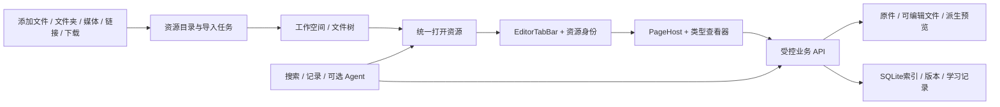

# 系统架构：资源驱动的本地学习工作台

2026-10-30统一添加：Windows原生多选/OLE拖放→同一Flutter待导入清单→受保护`resource-inspections`只读识别→显式确认→既有`resource-add-jobs`顺序后台复制。媒体视图复用该弹窗。资料处理通过`resources/{id}/analyze`读取并校验已有原件、复用ImportJob，不复制第二份；仍需预览和确认。导航移除辅助工具分组而保留旧utility/layout及页面生命周期；搜索在同空间未删除资源中分页。无新依赖/迁移，边界及证据见[本批记录](unified-resource-import-2026-10-30.md)。

2026-10-26：用户授权从R1复核后按R1–R6顺序继续开发、自动测试与审查。人工及阶段验收待统一进行。下文2026-10-25“仅授权R1”为历史边界；R2增量设计见[r2-design.md](r2-design.md)，本轮实际状态见[续开发记录](resource-continuation-2026-10-26.md)。

当前增量：R2资源身份/layout v2已实施；R3 PDF/图片阅读、Markdown工作副本及DOCX结构预览已接入，0008追加工作副本/保存收据；0009追加可选离线DOCX/PPTX分页任务与派生收据。固定LibreOffice独立profile/受限Job、静态内部图表/OMML与安全边界见[ADR0009](adr/0009-offline-office-previews.md)、[本批记录](r3-office-validation-2026-10-26.md)。首批工作文件设计见[r3-design.md](r3-design.md)、[ADR0008](adr/0008-resource-tabs-and-document-workfiles.md)。旧题目/作答权威链未切换，R4–R6尚未展开；不将本机冻结自动化当完整发行/阶段验收。

2026-10-25。产品方向与最小方案已由用户确认，本轮仅授权实施R1。资源目录/复制任务已落地（0007），[详细设计](r1-design.md)与[验证记录](r1-validation.md)单列；资源标签、查看器、题目MD和记录贯通仍为后续方案。未替换既有开发包。

## 保留的技术基线

Monorepo模块化单体：Flutter交互 → 受保护本地HTTP → Python应用服务 → SQLite及受管文件。沿用固定玻璃库公开API、WebView2/HTML5、SQLAlchemy/Alembic及冻结/安装流程。Python负责业务、路径/资源权限、文件处理和事务；不引入微服务、通用插件平台或第二套题目/播放后端。

可复用：Workspace隔离/归档、data_root迁移、EditorTabBar、WorkspaceLayout保存队列、PageHost稳定Key、Resource原件读取、ImportJob预览确认、DOCX/PDF受限解析、拆题编辑、QuestionDocument/判分、Attempt/AttemptReview追加和MediaEntry/独立播放器。新方向改变组织与关联，不表示已经有文件工作区。

## 目标结构

左侧树组织资源，中央按内容类型分派查看器。题库列表/计划/统计作为辅助视图，导入作为全局任务/对话流程；旧总览暂作兼容入口，不能继续决定新标签身份。

### 1. 资源目录与统一添加

2026-10-30增量：0012追加`workspace_nodes.removed_at`及未删除节点的同层名称唯一索引；受控DELETE事务标记整棵子树，复制任务运行时拒绝操作。列表/相对查找过滤，旧资源适配保留墓碑避免重现；原件/工作文件/历史与layout不删除，已打开编辑器仍按ID访问保留文件。见[设计与证据](resource-removal-2026-10-30.md)。

R1新增工作空间内的逻辑目录/资源身份层`workspace_nodes`。文件夹有稳定ID与父节点；当前资源节点定位现有Resource原件、MediaEntry或保存的网页链接，严格择一。工作文件分支留R3。先适配既有存储，不合并表或重排全部磁盘文件。

首批复制导入文件/文件夹并记录层级，原目录保持不变；树是受管资源的逻辑视图，**不承诺首次就原地打开任意系统目录**。相同字节可复用原件blob，不同逻辑文件仍有不同ID。改名/移动保持关系；递归导入有数量/大小/路径预算与显式失败处理。

R1统一添加调用Python资源编排，复用Resource原件、路径校验、MediaEntry/媒体容器校验和播放器；资料只保存原件，不先提取题目。既有ImportJob预览审核继续作为辅助工具，新增原件在刷新树时适配目录。视频下载入口明确提示未实现，服务仍属M4缺项。新库与新空间默认空工作区，已有空间名、v1布局与草稿保持原值。

### 2. 资源标签与查看器

标签保留`tab_id`，新增`resource_item_id`与受控`view_kind`，以`workspace_id + resource_item_id + view_kind`定位已有页。文件名、URL显示标题和SHA256是属性。默认同一文件的编辑/预览在页内切换；辅助计划/搜索视图用utility身份，不伪造文件ID。

扩展WorkspaceLayout与页面工厂，复用EditorTabBar/PageHost、加载/错误、关闭确认、快捷键及释放机制。新建默认进入欢迎/新文件/添加资源体验，不默认学习模块。

拟议布局v2兼容读取v1。旧question/study/import/player没有具体资源身份，**不得按标题或最后活动页猜测绑定文件**：先作为legacy utility恢复，保留草稿/顺序/关闭历史/网页URL；显式打开资源后才创建新标签。未知标签原样保留并提示。前后端严格校验、序列化和恢复测试共同变更。

### 3. 原件、工作文件、派生文件

- Resource原件继续不可变及哈希校验，不通过放宽`read_resource`容忍覆盖。
- Markdown编辑使用明确工作副本/新文件。磁盘文本是当前内容来源；SQLite解析内容是有hash/版本的索引或已确认快照。外部修改显示待解析/冲突，不能自动覆盖可判分缓存。
- 保存检查expected hash，同目录临时写入/原子替换并留恢复点。文件与SQLite非跨介质事务，要有小范围写入记录/重启对账及故障测试。首批在打开/刷新/保存时检测变更，不立即引入监听依赖。
- Word/PPT转换、PDF页图和缩略图是派生缓存，记录源ID/hash、转换器版本/选项。失败/过期不删除原件，不用派生PDF覆盖DOCX/PPTX。本地查看器按资源ID/专用能力授权，外部网页保持完全隔离。

查看器增量接入：Markdown原文/预览、PDF分页/缩放、图片、WebPage、指定MediaEntry的播放器；Word先结构预览，再按能力提供PDF/受控HTML；PPT需明确幻灯片转换能力。Docling提取/PDFium可复用，但不凭上游支持列表宣称产品PPT已可用。转换证据与发行边界见[审查报告](resource-first-architecture-review.md)。

### 4. 题目与记录

新增题目文件到既有题目ID/资源ID的映射，不重写判分器。拟议QuestionFile格式经解析、来源降权与用户确认，编译为QuestionDocument缓存；原件/MD、确认版本快照和作答历史各有职责。

新作答绑定题目ID及不可变确认版本，服务器据其判分；主观/缺答案待批改。改答案发布新版本，不改旧作答/快照。错误类型、自评、复习操作追加为事件，掌握状态可重算。旧记录无完整快照时标记历史版本不可追溯，禁止把当前文件冒充当年题目。历史可反向打开当前MD、快照、笔记和来源。

### 5. 可选 Agent

Agent调用同一套范围受控的读取、候选草稿、确认保存接口。题目/知识点/计划/变式建议均可审核；路径、ID、抽题、评分和事务由程序决定。模型不能直接操作磁盘/SQL/标准答案。无模型/网络仍能查看、编辑、抽题和记录，详见[权限设计](agent-design.md)。

## 迁移与实施门禁

沿用升级前SQLite备份、事务迁移、完整性校验和旧文件保留。R1经兼容审查仅追加0007目录与复制任务及必要唯一索引；不落地文件映射、确认版本或学习注记。后续分阶段按需落表，具体列/约束先过兼容审查。

R1资源管理器/统一添加基础 → R2资源标签 → R3查看器/编辑器 → R4题目MD/确认版本 → R5记录反向关联 → R6 Agent。R1包含最小迁移及旧库回归，R4/R5在映射/快照/双读通过前不开放新MD提交作答。完整备份恢复、下载队列等旧缺项保留并归入资源主线。

默认数据位置、Known Folder、配置拒写提示、数据锁和迁移不提权规则不变。当前开发包未替换；R1源码侧栏以资源树为主，旧业务页为辅助工具。历史启动/安装、DPI/原生焦点和人工/阶段验收不因自动化通过而清除。[任务](task.md)、[数据模型](data-model.md)、[历史架构全文](archive/resource-direction-baseline-2026-10-25.md)。

## R4确认链（0010）

资源文档页→QuestionFiles检查/确认服务→QuestionFile v1解析与附件校验→不可变MD/附件快照及question_versions→当前questions缓存→带版本的Attempt。UI不直连数据库；原件、旧JSON/旧提取MD和历史作答保留。快照落盘回读校验后提交，失败收据保留；当前文件无效时可用上次确认快照。复用PageHost隔离隐藏文档焦点、StudyAnswer保存独立作答草稿；无新增产品依赖。详见[ADR0010](adr/0010-question-files-and-confirmed-versions.md)、[文件格式](question-file-spec.md)和[R4证据](r4-validation-2026-10-26.md)。人工/阶段待验。

## R5完成批（2026-10-29）

LearningRecordDialog→受保护records_router→Attempt/QuestionVersion/学习事件/同空间Note与资源节点，串起历史快照、当前文件、来源及相关笔记。记录标签latest-explicit-annotation-v1和掌握attempt-review-streak-v1均可从追加记录重算，不允许注记改标准答案或覆盖旧分数。没有新增技术栈或产品依赖。见[R5完成记录](r5-completion-2026-10-29.md)，人工及阶段仍待验。
